# Translater : guide d'utilisation

Translater (« Traducteur » dans l'administration) permet de traduire les plugins et les thèmes de Dotclear sans quitter l'administration : ajouter une langue, saisir les traductions, faire des sauvegardes, exporter et importer des paquets de langues.

Ce guide s'adresse aux super-administrateurs : le plugin n'est accessible qu'à eux.

## Sommaire

* [Avant de commencer](#avant-de-commencer)
* [Accueil du plugin](#accueil-du-plugin)
* [Choisir un module](#choisir-un-module)
* [Ajouter une langue](#ajouter-une-langue)
* [Traduire les chaînes](#traduire-les-chaînes)
* [Sauvegarder et restaurer](#sauvegarder-et-restaurer)
* [Exporter et importer](#exporter-et-importer)
* [Le bouton Traduire](#le-bouton-traduire)
* [Réglages du plugin](#réglages-du-plugin)

## Avant de commencer

Dans ce guide, « module » désigne un plugin ou un thème installé.

Pour être traduit, un module doit avoir son dossier accessible en écriture par le serveur web. Translater écrit les traductions dans le dossier `locales/<code langue>/` du module.

Les modules livrés avec Dotclear sont cachés par défaut, car il vaut mieux ne pas les modifier (voir les [réglages](#réglages-du-plugin)).

Les exemples de ce guide utilisent un plugin imaginaire, « Livre d'or ».

## Accueil du plugin

Ouvrez le menu **Traducteur** de l'administration.

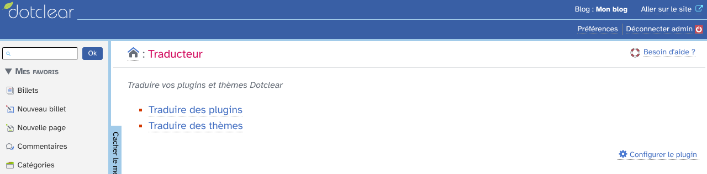

Deux liens :

* **Traduire des plugins** : la liste des plugins installés ;
* **Traduire des thèmes** : la liste des thèmes installés pour le blog courant.

Le lien **Configurer le plugin**, en bas de page, mène aux [réglages](#réglages-du-plugin). Il est utile de les parcourir avant la première utilisation.

Dans les réglages, le « menu de départ par défaut » permet d'ouvrir directement la liste des plugins ou celle des thèmes.

## Choisir un module

La liste des modules affiche, pour chacun, son identifiant, les langues déjà présentes, son nom et sa version.

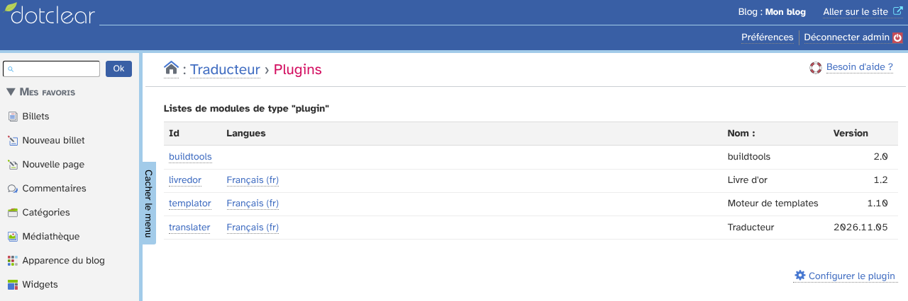

* Cliquez sur l'identifiant d'un module pour gérer ses langues ;
* cliquez sur une langue pour la modifier directement.

Un module absent de la liste n'est pas accessible en écriture, ou fait partie de la distribution de Dotclear.

La page d'un module résume où il se trouve (racine, dossier des langues, dossier des sauvegardes), puis propose ses traductions, ses sauvegardes, l'ajout d'une langue et l'import.

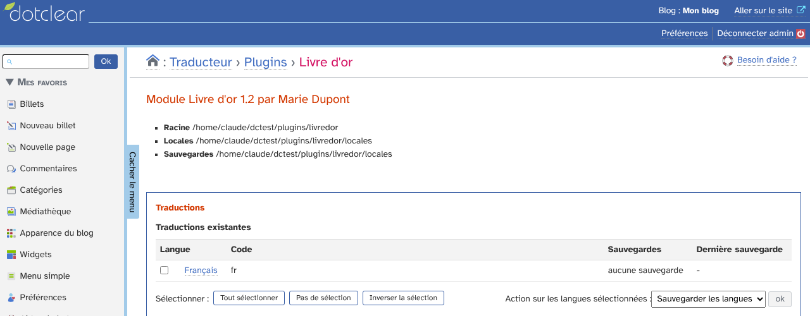

## Ajouter une langue

Dans le bloc **Ajouter une langue** de la page du module :

1. choisissez la langue dans la liste ;
2. cliquez sur **Créer**.

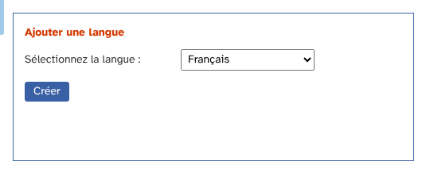

Translater cherche toutes les chaînes à traduire dans les fichiers du module et crée le fichier de langue.

Si le module a déjà une langue, vous pouvez en **copier** une : la nouvelle langue démarre alors avec les traductions de la langue choisie, ce qui est pratique pour partir d'une langue proche.

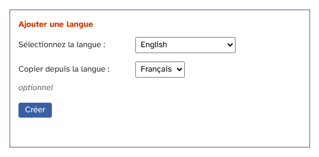

Seules les langues qui n'existent pas encore pour le module sont proposées.

## Traduire les chaînes

Cliquez sur une langue de la liste des traductions pour l'ouvrir.

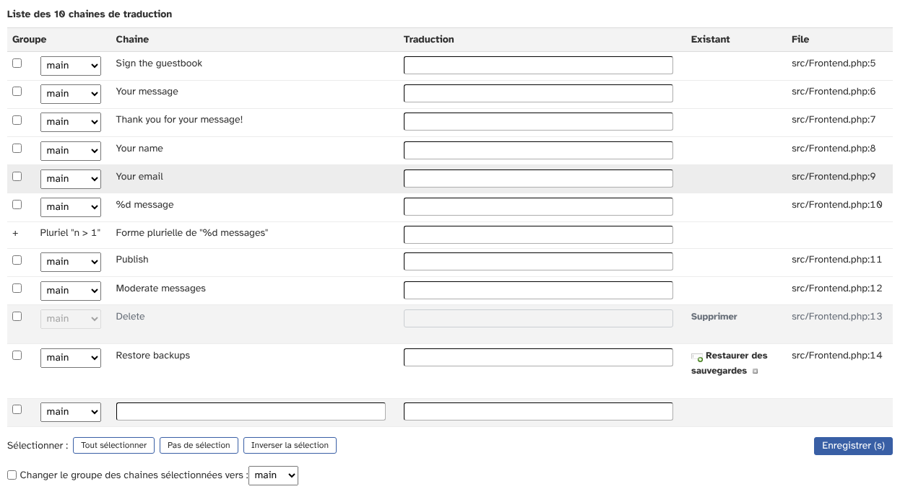

Le tableau liste toutes les chaînes du module :

* **Groupe** : le fichier de langue qui reçoit la chaîne. `main` est lu par Dotclear côté administration, `public` côté public. Gardez `main` sauf besoin particulier ;
* **Chaîne** : le texte d'origine ;
* **Traduction** : à saisir ;
* **Existant** : les traductions de la même chaîne déjà présentes dans d'autres modules. La première icône copie une traduction dans le champ, la seconde déplie la liste ;
* **File** : le fichier du module et la ligne où se trouve la chaîne.

Une ligne qui commence par **+** est la forme plurielle de la chaîne qui la précède.

Une ligne grisée est déjà traduite dans Dotclear : elle ne peut pas être modifiée tant que le réglage « Traduire uniquement les chaines inconnues » est actif.

Saisissez les traductions, puis cliquez sur **Enregistrer**.

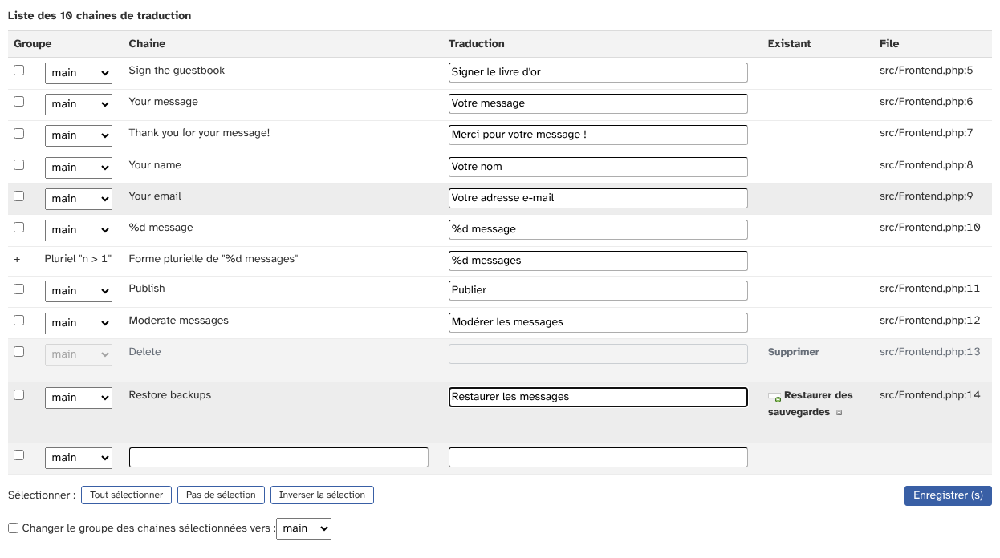

Quelques astuces :

* la dernière ligne, vide, permet d'ajouter une chaîne de votre choix ;
* pour déplacer des chaînes vers un autre groupe, cochez-les, cochez **Changer le groupe des chaines sélectionnées vers** puis choisissez le groupe avant d'enregistrer ;
* le raccourci clavier `s` enregistre.

Les traductions sont écrites dans des fichiers `.po` (par exemple `locales/fr/main.po`). Selon les réglages, Translater écrit aussi les fichiers `.lang.php`, plus rapides à charger pour Dotclear.

## Sauvegarder et restaurer

Dans la liste des traductions d'un module, cochez une ou plusieurs langues, choisissez l'action **Sauvegarder les langues** et cliquez sur **ok**.

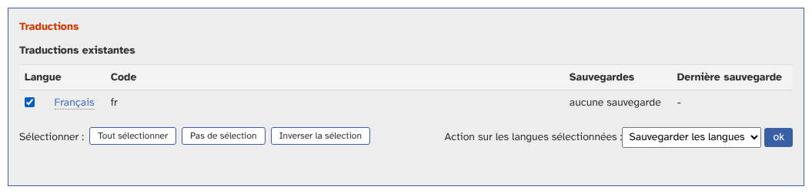

Chaque sauvegarde est un fichier zip. Elles sont listées dans le bloc **Sauvegardes**.

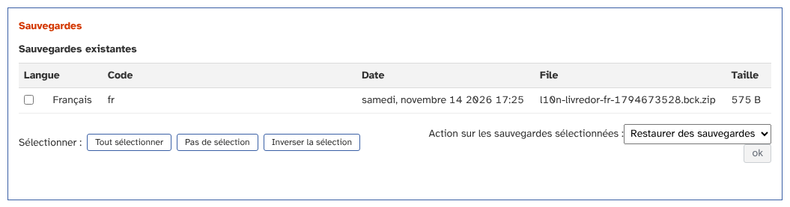

Cochez des sauvegardes puis choisissez :

* **Restaurer des sauvegardes** : remet les langues telles qu'elles étaient. Si plusieurs sauvegardes de la même langue sont restaurées en une fois, la plus ancienne est restaurée en premier ;
* **Effacer des sauvegardes**.

Pour sauvegarder automatiquement à chaque enregistrement, activez le réglage « Faire une sauvegarde quand des changements sont effectués ». Le nombre de sauvegardes par module est limité (20 par défaut) et les anciennes ne sont pas effacées toutes seules : il faut les supprimer ici.

## Exporter et importer

Pour **exporter**, cochez des langues dans la liste des traductions et choisissez l'action **Exporter les langues** : votre navigateur télécharge un paquet zip. Son nom se règle dans les [réglages](#réglages-du-plugin).

Pour **importer**, utilisez le bloc **Importer** de la page du module : choisissez le paquet (typiquement un zip exporté par Translater) puis cliquez sur **Importer**.

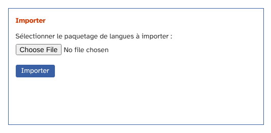

Si une langue du paquet existe déjà dans le module, elle n'est remplacée que si le réglage « Ecraser les langues existantes » est actif.

Pour supprimer une langue, cochez-la et choisissez **Effacer les langues**. Pensez à la sauvegarder avant.

## Le bouton Traduire

Si vous activez, dans les réglages, « Activer le menu sur la page des plugins », chaque plugin de la page de gestion des plugins reçoit un bouton **Traduire**, qui ouvre directement la page du module dans Translater.

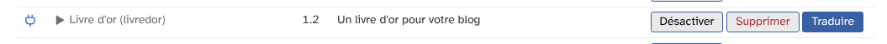

Le réglage « Activer le menu sur la page des thèmes » fait de même dans les détails des thèmes.

Le plugin peut aussi être ajouté au tableau de bord, depuis les favoris de vos préférences utilisateur.

## Réglages du plugin

Ils sont accessibles par le lien **Configurer le plugin** du plugin, ou depuis la page de gestion des plugins.

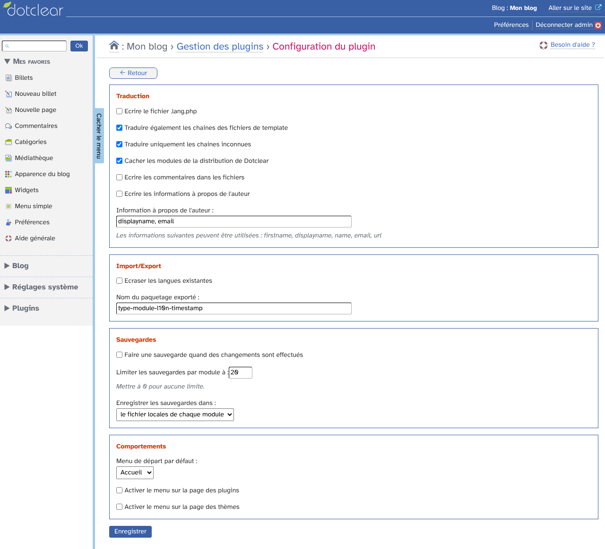

**Traduction**

* *Ecrire le fichier .lang.php* : écrit ce format rapide en plus du `.po` ;
* *Traduire également les chaines des fichiers de template* : cherche aussi les chaînes des balises `{{tpl:lang ...}}` des fichiers `.html` ;
* *Traduire uniquement les chaines inconnues* : grise les chaînes déjà traduites par Dotclear (recommandé) ;
* *Cacher les modules de la distribution de Dotclear* ;
* *Ecrire les commentaires dans les fichiers* : ajoute le fichier et la ligne de chaque chaîne. Pratique pendant le développement d'un module, à désactiver pour une version finale ;
* *Ecrire les informations à propos de l'auteur* : ajoute l'auteur de la traduction. Les informations s'écrivent avec `firstname`, `displayname`, `name`, `email` et `url`.

**Import/Export**

* *Ecraser les langues existantes* à l'import ;
* *Nom du paquetage exporté* : peut contenir `type`, `module`, `version`, `timestamp` et les masques de date de Dotclear. Exemple : `type-module-l10n-timestamp`.

**Sauvegardes**

* *Faire une sauvegarde quand des changements sont effectués* ;
* *Limiter les sauvegardes par module à* : 0 pour aucune limite ;
* *Enregistrer les sauvegardes dans* : le dossier `locales` de chaque module, la racine du dossier des plugins, celle du dossier public, le dossier cache de Dotclear, ou le dossier `locales` de Translater. Le dossier choisi doit être accessible en écriture.

**Comportements**

* *Menu de départ par défaut* : Accueil, Plugins ou Thèmes ;
* les deux réglages du [bouton Traduire](#le-bouton-traduire).
